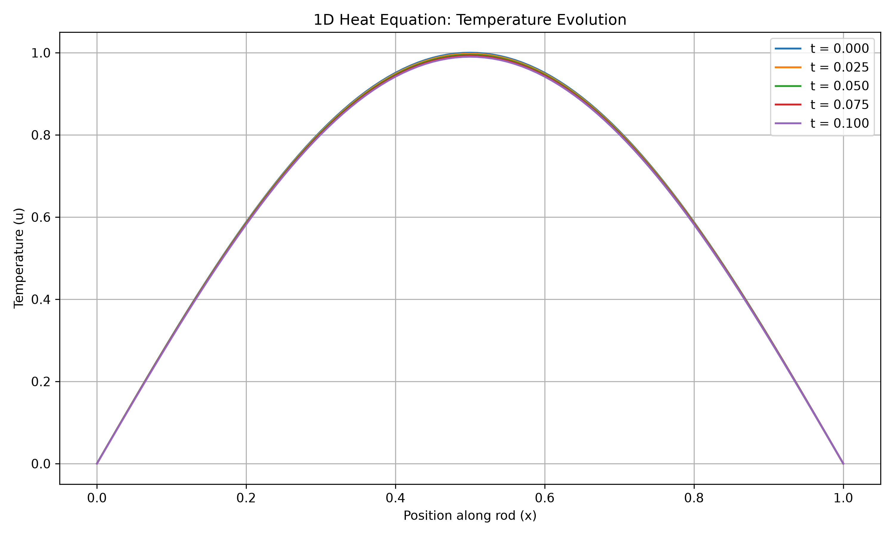

# 1-D Heat Rod Simulation

A numerical simulation of heat diffusion through a one-dimensional rod. The project solves the heat equation using an explicit finite-difference method in C++, with both sequential and OpenMP-parallel implementations.

## Highlights

- Solves the one-dimensional heat equation:

  ```text
  ∂u/∂t = α ∂²u/∂x²
  ```

- Explicit finite-difference time integration
- Fixed-temperature boundary conditions at both ends of the rod
- Sinusoidal initial temperature distribution
- CFL-style stability check before the simulation runs
- OpenMP version for parallel spatial updates
- CSV output for every spatial point and time step
- Python visualisation scripts for simulation results

## Simulation setup

| Parameter | Value |
|---|---:|
| Rod length, `L` | 1.0 |
| Thermal diffusivity, `α` | 0.01 |
| Spatial grid points, `N` | 101 |
| Spatial step, `dx` | 0.01 |
| Time step, `dt` | 0.0001 |
| Final simulation time | 0.1 |
| Number of time steps | 1000 |
| Stability parameter, `r = αdt/dx²` | 0.01 |

The explicit solver is stable when `r ≤ 0.5`. This simulation uses `r = 0.01`.

## Initial and boundary conditions

The initial temperature distribution is:

```text
u(x, 0) = sin(πx / L)
```

Both ends of the rod are held at zero temperature:

```text
u(0, t) = 0
u(L, t) = 0
```

## Results

The temperature profile gradually diffuses and cools over time while maintaining the fixed boundary temperatures.



Simulation data is saved as CSV files in `results/`:

- `heat_equation.csv` — sequential solver output
- `heat_equation_openmp.csv` — OpenMP solver output

Each file contains:

```text
time,x,temperature
```

## Project structure

```text
.
├── src/
│   ├── heat_equation.cpp
│   ├── heat_equation_openmp.cpp
│   └── Makefile
├── Scripts/
│   └── visualize_heat.py
└── results/
    ├── heat_equation.csv
    ├── heat_equation_openmp.csv
    └── heat_equation.png
```

## Build and run

Compile the sequential version:

```bash
g++ -O2 -std=c++17 src/heat_equation.cpp -o heat_equation
./heat_equation
```

Compile the OpenMP version:

```bash
g++ -O2 -std=c++17 -fopenmp src/heat_equation_openmp.cpp -o heat_equation_openmp
./heat_equation_openmp
```

## Visualise results

```bash
python3 Scripts/visualize_heat.py
```

## Technologies

- C++
- OpenMP
- Python
- NumPy, Pandas, and Matplotlib
